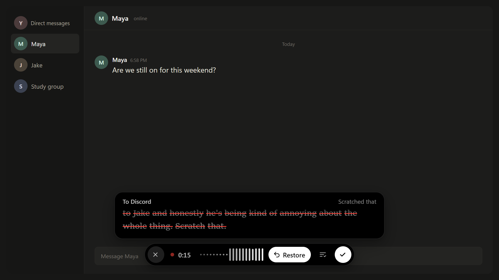
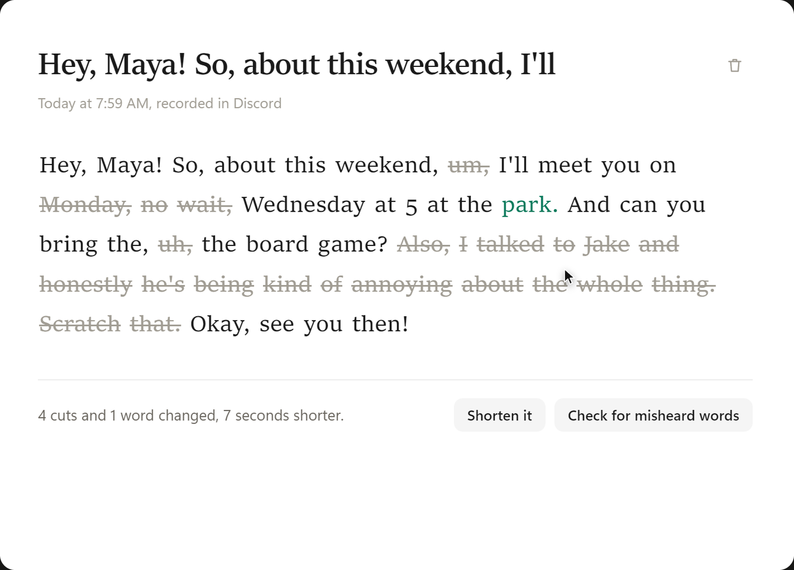
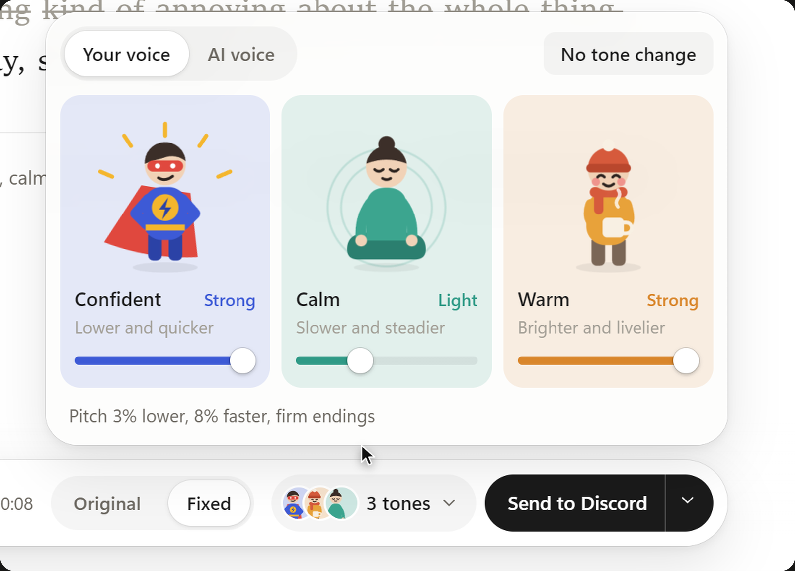
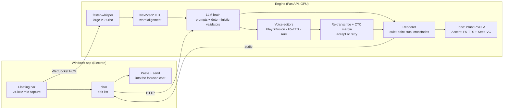

# Ctrl+Voice

**Say it messy. Send it clean.**

Voice messages you can edit like text, in your own voice. Press a key in any chat and talk. Say "scratch that" and the last thought disappears while you keep talking. When you finish, Ctrl+Voice cuts the ums and false starts, fixes "Monday, no wait, Wednesday", says misspoken words again in your voice and sends the message into Discord, WhatsApp, Telegram, Slack, Signal or Teams.

Cuts keep your real audio. Only the few words you change are generated, from the audio around them, and each one is checked by re-transcribing it before it is spliced in.

<p align="center"></p>

| The editor shows every change | Tone in your own voice |
|---|---|
|  |  |

## What it does

| | |
|---|---|
| **Live undo** | "Scratch that", "delete that", "start over", or `Ctrl+Z` while recording. The words are struck through on screen about 350 ms later. |
| **Clean up** | Fillers, false starts, repeats and self-corrections ("Monday, no wait, Wednesday" → "Wednesday"), cut at quiet points with 12 ms crossfades so the seams are inaudible. |
| **Replace a word in your voice** | Select a word, type the new one. Two voice-editing models (PlayDiffusion and F5-TTS) generate it in parallel from the surrounding audio; the one that re-transcribes correctly is spliced in. |
| **Misspoken words** | "pacific" for "specific", "bored game" for "board game": an LLM proposes the word you meant, a phoneme model checks it matches the sounds you made, and the word is said again in your voice. |
| **Grammar** | Suggested fixes, rendered in your own voice and verified the same way. |
| **Pronunciation coach** | Flags words that came out unclear (a detector trained on speechocean762 expert scores) and re-says them clearly. |
| **Tone** | Confident, Calm and Warm sliders that mix into one pitch-and-pace change of your own recording (Praat PSOLA): no neural regeneration, so the voice stays yours. Confident also shortens hesitation pauses and tightens speech that trails off. An optional AI restyle has more styles. |
| **Native accent** | The whole message said again with a native English accent by an AI voice, then converted back toward your voice (F5-TTS + Seed-VC). Clearly labelled as AI in the app. |

The original recording is never modified. Every edit is a time range in an edit list (`cut` or `insert`), rendered when you play or send, so any change can be undone.

## How fast

Measured on the running engine (one A100 80 GB, warm), for a 10–15 s message:

| Step | Time |
|---|---|
| Live transcript and "scratch that" | ~350 ms behind speech |
| Upload and transcribe | 0.4 s |
| Clean up (LLM + validators) | 0.5 s |
| Natural tone (pitch and pace) | 0.6 s round trip |
| Native accent, whole message | 2.8 s |
| Replace a word (two models in parallel + verification) | ~3 s |

## How it works



- **The LLM never edits audio directly.** It returns which words to cut or change, and deterministic validators reject anything that would change the meaning (in testing, 0 of 10 trick sentences had meaning-changing edits).
- **Generated words are verified.** Each replacement is re-transcribed and scored against the target with a character CTC model; a word that fails is regenerated or rejected, never sent.
- **Any OpenAI-compatible LLM works.** By default the brain is Qwen3.6-35B-A3B on vLLM on the same GPU; set `LLM_URL`, `LLM_KEY` and `LLM_MODEL` to use a hosted model instead.

## Run it

### The app (Windows)

```
cd desktop
npm install
npm start
```

Set the engine address in **Settings → Engine** and press **Check**. Then open a chat and press `` Alt+` `` (the key under Esc) to record; press it again to send. Full shortcut list and behaviour: [`desktop/README.md`](desktop/README.md).

### The engine (Linux, NVIDIA GPU)

Tested on Ubuntu 24.04, CUDA 12.8, one A100 80 GB. The paths assume a `/workspace` root (the RunPod default); on your own machine, create it or symlink it (`sudo ln -s ~/cv-workspace /workspace`).

```
/workspace/app    <- app/           /workspace/lab   <- lab/
/workspace/repos  <- model repos    /workspace/envs  <- core + vllm venvs
/workspace/hf     <- HF cache       /workspace/logs, /workspace/app_data
```

1. System packages: `apt-get install -y ffmpeg sox libsndfile1 espeak-ng`, and install [`uv`](https://github.com/astral-sh/uv).
2. Clone the voice-model repos into `/workspace/repos`: `playht/PlayDiffusion`, `SWivid/F5-TTS`, `Tencent-Hunyuan/AuK` (optional: `studio-dots-ai/dots.tts`).
3. Run `scripts/install_all.sh` (creates the venvs and downloads weights), then the extras:
   - core venv: `uv pip install pyarrow pandas datasets httpx websockets phonemizer scikit-learn`
   - PlayDiffusion venv: `uv pip install "setuptools<81" "pyarrow<15" fastapi uvicorn`
   - every model venv: `uv pip install fastapi uvicorn`
   - vLLM: `uv venv /workspace/envs/vllm/.venv --python 3.12 && uv pip install vllm ninja`
   - native accent (optional): `scripts/install_accent.sh`
4. Start the LLM, the voice editors, then the engine:
   ```
   scripts/start_llm.sh                      # Qwen3.6-35B-A3B-FP8 on :8011
   app/start_services.sh playdiff f5 auk     # :8101 :8103 :8102
   app/start_app.sh                          # engine on :7860
   ```
5. Open `http://<host>:7860` for the engine's own web UI ("Try a sample message" works without a mic), or point the desktop app at it.

With 48 GB, leave out AuK. On a smaller card (24–32 GB), use a hosted LLM through `LLM_URL` and run only `playdiff f5`; we have not measured that setup yet.

Engine API: `/ws/{sid}` (live PCM, words, undo), `/api/upload`, and per session `/api/s/{sid}/` `clean`, `tighten`, `grammar`, `pron`, `intent`, `replace`, `render`, `natural`, `tone`, `accent`, `state`.

## Built on research

Before writing the app we tested the candidate models on real recordings. Everything is in [`docs/RESULTS.md`](docs/RESULTS.md), with the experiment code in [`lab/`](lab):

- **Word replacement, 10 real recordings:** PlayDiffusion + splice 9/10 correct at 1.5 s, voice similarity 0.976; dots.tts.edit + splice 10/10 at 12.7 s.
- **Clean up, 28 messages including 10 trick sentences:** 24/28 exact; 0/10 meaning-changing edits.
- **Grammar in your voice:** 8/8 fixes rendered and verified on real second-language speakers (EdAcc).
- **Pronunciation detector:** AUC 0.88 against expert labels (speechocean762).
- **Native accent:** word error rate 0.04 on a Russian speaker, voice similarity 0.64.

Two long research reports cover the model landscape, grammar, pronunciation and accent: [`reports/`](reports), sources in [`research_notes/`](research_notes). Listen to every test clip in [`docs/listening_page.html`](docs/listening_page.html); the architecture page is [`docs/architecture.html`](docs/architecture.html).

## Roadmap

- **Native voice-message bubble.** Messages arrive as audio attachments today. Next: official integrations (a Telegram bot, a Discord app) that return the cleaned note as a real voice message.
- **On-device first pass.** Live transcript, undo and clean-up on the laptop (whisper + a small LLM); the GPU is only needed for words said in your voice.
- **Hosted LLM by default.** Frees about 40 GB of GPU for the most accurate voice editor (dots.tts.edit) and makes the engine fit on a single 24 GB card.
- **Seams nobody can hear.** Room-tone fill and pitch smoothing at joins, measured with a blind "spot the edit" listening test.
- **Provenance.** An AudioSeal watermark on every generated word, and a "words changed" note the listener can see.
- **More languages.** The pipeline is language-agnostic except the aligner and the pronunciation model.
- **macOS and mobile keyboards.** The same record → fix → send flow as a keyboard extension.

## Repo layout

| Path | What |
|---|---|
| `desktop/` | The Windows app (Electron): tray, floating recording bar, editor, settings, sending into chat apps |
| `app/` | The engine: `app.py` (FastAPI server, live loop, all endpoints, verification), `brain.py` (LLM prompts and validators), `render.py` (edit list → audio), `pron.py` (pronunciation scorer), `prosody.py` (natural tone), `editor_service.py` (one server per voice model), `accent_service.py` (native accent) |
| `lab/` | Benchmarks and experiments; `lab/align.py` (forced aligner) is used by the engine |
| `scripts/` | Install and start scripts |
| `docs/` | Results, architecture, handoff notes, listening page |
| `demo/` | Pitch deck, demo video project, test takes and end-to-end harnesses |
| `reports/`, `research_notes/` | The research rounds |

## Licences

The models this uses carry their own licences; check them before shipping a product: F5-TTS weights CC BY-NC, PlayDiffusion (archived repo), AuK depends on Qwen2.5-Omni-3B (research licence), dots.tts Apache-2.0. Datasets used in evaluation: speechocean762 CC BY 4.0, EdAcc CC BY-SA 4.0, DisfluencySpeech Apache-2.0, AMI CC BY 4.0, Speech Accent Archive CC BY-NC-SA 4.0.
